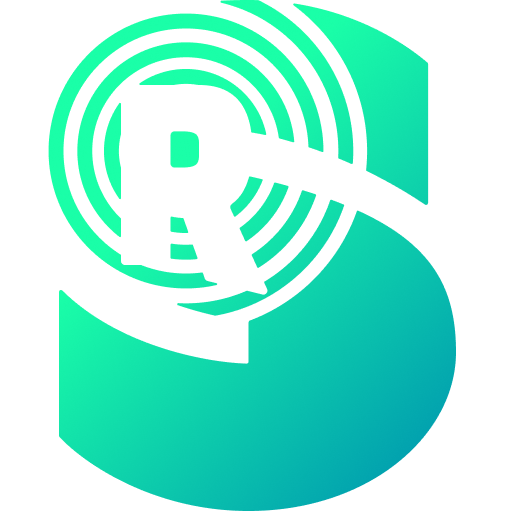

<p align="center">
  
</p>

<h1 align="center">Resound</h1>

<p align="center">
  A free soundboard for Windows that you control from your phone.
</p>

<p align="center">
  <a href="https://github.com/motivated2die/resound/releases/latest"><b>Download</b></a> ·
  <a href="https://getresound.app">Website</a> ·
  <a href="https://getresound.app/help/">Help</a> ·
  <a href="https://github.com/motivated2die/resound/issues/new?template=bug_report.yml">Report a bug</a> ·
  <a href="https://github.com/motivated2die/resound/issues/new?template=feature_request.yml">Suggest a feature</a>
</p>

Resound plays sounds to your own speakers and into a virtual audio cable at the same time, so your friends hear them in games and voice chat. It lives in the system tray and is a single small program: no runtime to install, no admin rights needed.

**Getting started:** download **Resound.exe** from the [latest release](https://github.com/motivated2die/resound/releases/latest), run it, and follow the guided setup. The [help center](https://getresound.app/help/) covers setup, voice chat apps and troubleshooting.

## Features

- **Play into voice chat.** Sounds go to your speakers ("You hear") and to [VB-Cable](https://vb-audio.com/Cable/) ("Others hear"), with separate volumes. Your microphone keeps working through the cable.
- **Phone app.** Scan a QR code and the Resound app opens on your phone; install it from the browser, no app store needed. It connects straight to your PC over your network, keeps the screen on and runs fullscreen. Tabs, favorites, colors and emoji per sound, custom layouts, play progress, stop and pause.
- **Your folders are your library.** Add folders by drag and drop, empty ones too; each folder and subfolder (at any depth) becomes a tab. MP3, WAV, FLAC and OGG. Renaming or moving files keeps their settings.
- **Import from Myinstants.** Drag a sound from [Myinstants](https://www.myinstants.com/) or [Sound Buttons World](https://soundbuttonsworld.com/) (or any link to a sound file) onto one of your folders: Resound downloads it there and lets you name it. No account needed.
- **Cut sounds from videos.** Drop a video (or audio in another format) onto a folder: it opens in an audio editor in your browser, and every clip you cut is saved into that folder.
- **Mic mute and push-to-talk.** While a sound plays, Resound can mute your real microphone and hold your game's push-to-talk key. "Talk through" lets you speak over a sound. Optional pause and stop keys work from inside your game: hold a pause key to pause the sounds and release push-to-talk (for example to talk on another channel), or press a stop key to end them at once.
- **Guided setup.** A short first-run setup covers sounds, speakers, voice chat, push-to-talk and the phone. It can install VB-Cable for you (downloaded from VB-Audio, signature checked).
- **Backup and restore** of all settings in one click.
- **One-click updates.** Resound shows a dot next to its name when a new release is out, and updates itself without touching your settings.

## Download and install

1. Download **Resound.exe** from the [latest release](https://github.com/motivated2die/resound/releases/latest).
2. Run it. Resound installs itself for your Windows user (`%LOCALAPPDATA%\Programs\Resound`), adds a Start Menu entry and starts. When a new release is out, Resound shows a dot next to its name; Settings → App & startup → "Update now" updates it and keeps your settings. Running a newer download by hand does the same.
3. Click the tray icon and follow the guided setup.

**"Windows protected your PC"?** Releases are not code-signed yet (see [Code signing policy](#code-signing-policy)), so Windows SmartScreen may warn about the download. Choose **More info → Run anyway**. To make sure the file is the one published here, compare its SHA-256 with the one in the release notes:

```powershell
(Get-FileHash .\Resound.exe -Algorithm SHA256).Hash
```

**Requirements:** Windows 10 or 11 (64-bit). For "Others hear": VB-Audio Virtual Cable, which the setup can install for you.

**Uninstall** from Settings → Apps → Installed apps, or in Resound under Settings → App & startup.

## Voice chat and VB-Cable

Games and voice chat apps hear Resound through a virtual microphone, "CABLE Output", provided by [VB-Audio Virtual Cable](https://vb-cable.com) by VB-Audio Software. VB-Cable is **donationware**: if you use it, please consider [supporting VB-Audio](https://vb-audio.com/Services/licensing.htm). Resound never bundles or modifies VB-Cable: when you choose "Install VB-Cable", it downloads the original package from VB-Audio, checks its digital signature and runs VB-Audio's own setup, which asks for your permission (UAC).

## Privacy

Resound has no accounts, no telemetry and no ads. Everything stays on your PC; your phone talks to it directly over your local network. See the [privacy policy](PRIVACY.md) for the few connections it makes.

## Code signing policy

Releases are built automatically from this repository's source code by GitHub Actions ([release workflow](.github/workflows/release.yml)), and every release lists the SHA-256 of its files. The build and release process is documented in [docs/RELEASING.md](docs/RELEASING.md).

Releases are **not code-signed yet**. We intend to apply for free code signing through the SignPath Foundation; this section will name the certificate once one is issued.

- **Committers and reviewers:** [the repository's maintainers](https://github.com/motivated2die/resound/graphs/contributors)
- **Approvers:** [motivated2die](https://github.com/motivated2die)
- **Privacy:** see the [privacy policy](PRIVACY.md).

## Feedback and building

Bug reports and feature ideas are welcome as [issues](https://github.com/motivated2die/resound/issues/new/choose). Pull requests from outside contributors aren't accepted at the moment; see [CONTRIBUTING.md](CONTRIBUTING.md). Security problems: [SECURITY.md](SECURITY.md).

- [docs/BUILDING.md](docs/BUILDING.md): setting up, building, testing and debugging.
- [docs/RELEASING.md](docs/RELEASING.md): versions, tags and how a release is made.
- [docs/ARCHITECTURE.md](docs/ARCHITECTURE.md): how Resound works inside.

## Credits and license

Resound builds on ideas from [Soundux](https://github.com/Soundux/Soundux) and the Soundux Remote, rewritten from scratch in Go. Third-party components and their licenses are listed in [THIRD_PARTY_NOTICES.md](THIRD_PARTY_NOTICES.md).

Resound is free software, licensed under the [GNU General Public License v3.0](LICENSE).
